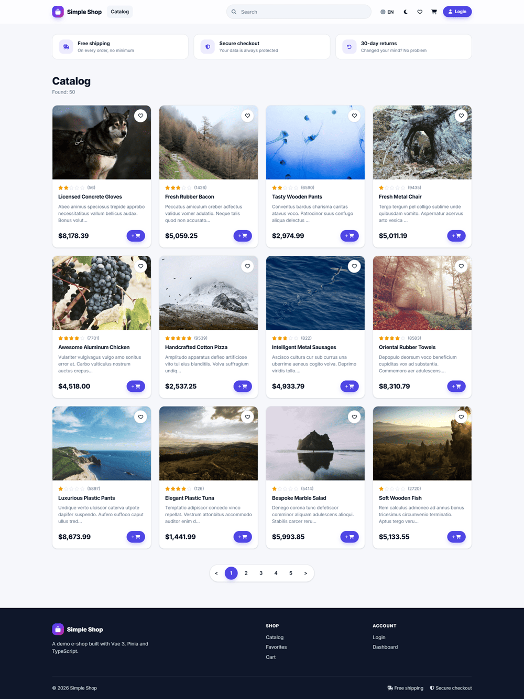

# vue-simple-eshop

A simple demo e-shop built with **Vue 3**, **Pinia**, and **TypeScript**. The project includes a product showcase, shopping cart, favorites list, checkout, and an admin panel for content management.

[](git/origin/main-page.png)

Click the image to open the [full-size screenshot](git/origin/main-page.png).

## ✨ Key Features

### Showcase and Products
*   **Product Catalog**: View the list of available products with images, descriptions, and prices.
*   **Search**: Quickly find products by name.
*   **Pagination**: Easy navigation through a large number of products.
*   **Detail Page**: Detailed information about each product.

### Shopping and Favorites
*   **Shopping Cart**: Add products, manage quantities, remove items.
*   **Favorites**: Save your favorite products to a separate list.
*   **Checkout**: A full checkout form with data validation.
*   **Order History**: View order status after placement.

### Admin Panel
*   **Product Management**: Create, edit, and delete products from the catalog.
*   **Order Management**: View the list of all incoming orders.
*   **Authorization**: Login to the admin panel using JWT (token lifetime 1 hour, verified on the server).

### Miscellaneous
*   **Localization (I18n)**: Support for Russian and English languages (RU/EN).
*   **Responsiveness**: Bootstrap 5-based interface displays correctly on various devices.
*   **Light / Dark Theme**: Switch in the header; the choice is remembered, the system theme is used by default.

---

## 🛠 Technology Stack

*   **Frontend**: [Vue 3](https://vuejs.org/) (Composition API)
*   **State Management**: [Pinia](https://pinia.vuejs.org/)
*   **Language**: [TypeScript](https://www.typescriptlang.org/)
*   **Build Tool**: [Vite](https://vitejs.dev/)
*   **Styling**: [Bootstrap 5](https://getbootstrap.com/), [SCSS](https://sass-lang.com/), [Font Awesome 6](https://fontawesome.com/)
*   **Validation**: [Vuelidate](https://vuelidate-js.netlify.app/)
*   **HTTP Client**: [Axios](https://axios-http.com/)
*   **Backend Simulation**: [json-server](https://github.com/typicode/json-server) + JWT Auth Middleware

---

## 🚀 Quick Start

**Node.js** (version 24+) or **Docker** is required to run the project.

### Option 1: Local Setup (npm)

1.  **Install dependencies**:
    ```bash
    npm install
    ```

2.  **Run backend simulation** (will open on port 3500):
    ```bash
    npm run json
    ```

3.  **Run Frontend application** (in another terminal window, will open on port 5174):
    ```bash
    npm run dev
    ```

### Option 2: Run via Docker

If you have Docker and Docker Compose installed:

```bash
docker-compose up --build
```

After startup, the application will be available at `http://localhost:5174` and the API at `http://localhost:3500`.

### API URL

By default the frontend uses the current host on port `3500`. To use another API, create `.env.local`:

```bash
VITE_API_URL=http://my-api-host:3500
```

---

## 📜 Available Scripts

*   `npm run dev` — starts the Vite development server.
*   `npm run json` — starts `json-server` for working with data (`data.js`).
*   `npm run build` — type checks and builds the project for production.
*   `npm run type-check` — runs the TypeScript type checker.
*   `npm run lint` — checks and fixes code formatting issues via ESLint.
*   `npm run test:unit` — runs unit tests via Vitest.

---

## 🧪 Testing

Unit tests (Vitest + jsdom) cover the stores: cart, favorites, locale, alerts and loader.

```bash
npm run test:unit
```

---

## 🔒 Admin Credentials

Default credentials: `admin` / `admin`. They (and the JWT secret) can be overridden with the `ADMIN_USERNAME`, `ADMIN_PASSWORD` and `APP_SECRET` environment variables of `npm run json`.

Without a token, the API allows only reading products and placing orders; managing products and viewing or changing orders requires the admin token.

---

Developed as a demo project to explore the capabilities of Vue 3 and Pinia.
